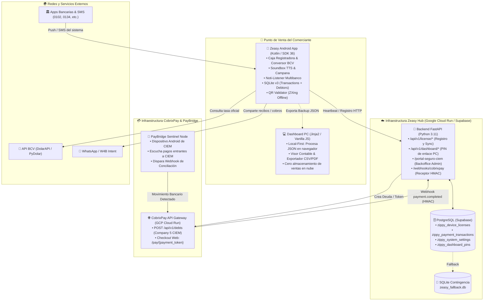
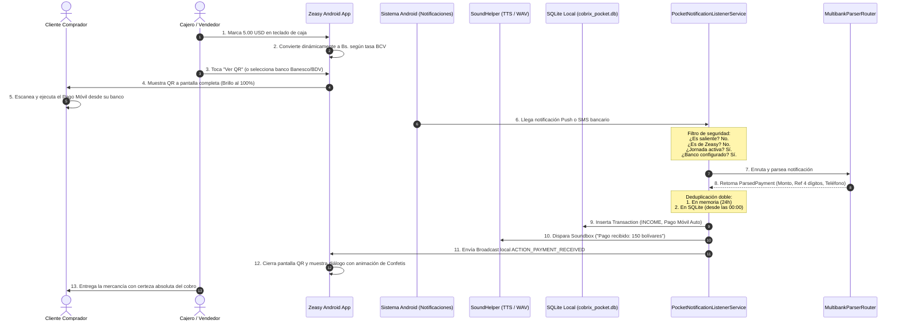
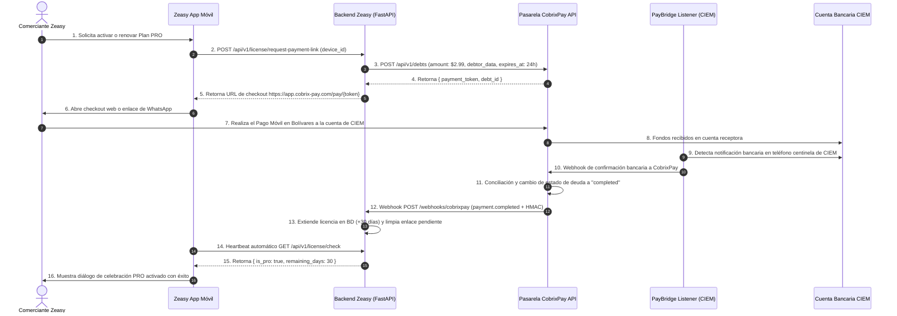

# ⚡ AUDITORÍA TÉCNICA Y ARQUITECTÓNICA PROFUNDA: PROYECTO ZEASY
**Ecosistema Comercial de Caja Rápida, Soundbox Bancario, Libreta de Fiados y Licenciamiento SaaS**  
*Autor: Arquitecto de Software Senior & Especialista en Android, FastAPI y FinTech*  
*Fecha de Auditoría: Noviembre 2026*  
*Entidad Propietaria: CIEM Tech Solutions C.A (RIF: J-50849495-4)*

---

## 📑 ÍNDICE GENERAL

1. [Resumen Ejecutivo](#1-resumen-ejecutivo)
2. [Mapa de Arquitectura del Ecosistema](#2-mapa-de-arquitectura-del-ecosistema)
3. [Inventario Funcional y Estado de Implementación](#3-inventario-funcional-y-estado-de-implementación)
4. [Explicación Exhaustiva de Módulos](#4-explicación-exhaustiva-de-módulos)
5. [Diagramas de Flujos Principales](#5-diagramas-de-flujos-principales)
6. [Análisis Forense de la Detección Bancaria](#6-análisis-forense-de-la-detección-bancaria)
7. [Análisis del Almacenamiento, Persistencia y Sincronización](#7-análisis-del-almacenamiento-persistencia-y-sincronización)
8. [Análisis del Esquema de Licenciamiento PRO y Monetización](#8-análisis-del-esquema-de-licenciamiento-pro-y-monetización)
9. [Análisis de Integraciones Externas](#9-análisis-de-integraciones-externas)
10. [Fortalezas del Producto](#10-fortalezas-del-producto)
11. [Debilidades, Vulnerabilidades y Riesgos Técnicos](#11-debilidades-vulnerabilidades-y-riesgos-técnicos)
12. [Matriz de Oportunidades de Mejora](#12-matriz-de-oportunidades-de-mejora)
13. [Preguntas Clave que Requieren Validación Operativa](#13-preguntas-clave-que-requieren-validación-operativa)
14. [Conclusiones y Dictamen de Arquitectura](#14-conclusiones-y-dictamen-de-arquitectura)

---

## 1. RESUMEN EJECUTIVO

El proyecto **Zeasy** (anteriormente conocido como **Cobrix-Pocket** y **Zippy**) es una solución de punto de venta (POS) móvil, caja rápida y "Soundbox digital" orientada a resolver los problemas estructurales del comercio minorista e informal en Venezuela (bodegas, panaderías, ferreterías, taxistas, farmacias y pres+tadores de servicios).

### Propósito del Producto
En el mercado venezolano, la ausencia de APIs bancarias públicas para comercios minoristas y la hiper-fragmentación del pago móvil generan tres dolores graves:
1. **El fraude por capturas falsas:** Comprobantes digitales editados o SMS simulados entregados al vendedor en caja.
2. **La fricción en la cola:** La necesidad de dictar teléfono, cédula y banco, o de que el dueño abra la app del banco cada 2 minutos para verificar un cobro.
3. **El desorden de las cuentas por cobrar:** La clásica "libreta de papel" de fiados y vueltos pendientes, sujeta a extravíos y disputas sobre la tasa de cambio aplicable.

Zeasy convierte cualquier teléfono inteligente Android en un terminal de punto de cobro con **pantalla de QR al 100% de brillo**, **teclado financiero con conversión automática a tasa oficial BCV**, **detección en tiempo real de notificaciones bancarias entrantes (Push y SMS)**, **anuncio sonoro por voz (Soundbox TTS)** y una **Libreta de Fiados y Saldos a Favor (Micro-Ledger)** con cobro asistido por WhatsApp.

### Estado Global del Software
Tras una auditoría minuciosa del código fuente en los repositorios [mobile](file:///home/ildemaro-carrasco/Ciem/cobrix-pay/zeasy-app/mobile) y [web](file:///home/ildemaro-carrasco/Ciem/cobrix-pay/zeasy-app/web), se concluye que:
- **Nivel de Madurez:** Producto comercial real, no un prototipo. La aplicación móvil está compilada contra Android SDK 36 (Android 16 / VanillaIceCream), con versión 1.3.6 (versionCode 11).
- **Paradigma de Diseño:** **Local-First / Offline-First**. El 95% de la lógica operativa (caja, detección bancaria, cálculo de tasas, base de datos de transacciones y libreta de fiados) reside y funciona enteramente sin internet en el dispositivo móvil.
- **Estado de Monetización:** Existe un circuito automático funcional entre la app móvil Zeasy, el backend FastAPI (`zeasy-web`), la pasarela [CobrixPay](file:///home/ildemaro-carrasco/Ciem/cobrix-pay/cobrixpay-backend) y la tecnología [PayBridge](file:///home/ildemaro-carrasco/Ciem/cobrix-pay/pay-bridge).
- **Hallazgo Crítico Inmediato:** El código Android posee la bandera `PLAY_STORE_REVIEW_MODE = true` en [PlanCapabilityManager.kt:L42](file:///home/ildemaro-carrasco/Ciem/cobrix-pay/zeasy-app/mobile/app/src/main/java/com/cobrix/pocket/utils/PlanCapabilityManager.kt#L42), lo cual desbloquea incondicionalmente todas las funciones PRO para cualquier usuario mientras se aprueba en Google Play Console. Adicionalmente, el módulo de "Respaldo en la Nube" ([CloudSyncService.kt:L75-L77](file:///home/ildemaro-carrasco/Ciem/cobrix-pay/zeasy-app/mobile/app/src/main/java/com/cobrix/pocket/utils/CloudSyncService.kt#L75-L77)) es una simulación local en SharedPreferences y no un servicio HTTP real conectado a un servidor.

---

## 2. MAPA DE ARQUITECTURA DEL ECOSISTEMA

El ecosistema está compuesto por cuatro subsistemas claramente coordinados:



### Componentes de Software Identificados

| Componente | Directorio / Archivo | Rol Tecnológico | Responsabilidad |
|---|---|---|---|
| **Zeasy Mobile** | `mobile/` | Android Nativo (Kotlin 1.9, Coroutines, ViewBinding) | Terminal de caja, escucha de notificaciones bancarias, soundbox TTS, validación QR, libreta de fiados y persistencia SQLite local. |
| **Zeasy Web & Hub** | `web/app/` | Python 3.11, FastAPI, SQLAlchemy, Jinja2, Uvicorn | Portal web público, instructivo, landing de planes, API de licencias para la app móvil y receptor de webhooks de pago. |
| **Dashboard Web PC** | `web/app/templates/dashboard.html` | SPA Vanilla JS / CSS en navegador | Visor contable y auditoría de jornada para PC; procesa respaldos JSON de forma 100% local en memoria y `localStorage`. |
| **Panel Administrativo** | `web/app/routers/admin.py` | FastAPI + Jinja2 + Auth basada en Cookies | Backoffice privado para activación manual de licencias, extensión de días PRO, anulación de deudas y monitoreo comercial. |
| **Base de Datos Cloud** | [models.py](file:///home/ildemaro-carrasco/Ciem/cobrix-pay/zeasy-app/web/app/models.py) | PostgreSQL (Supabase) con fallback a SQLite | Registro de dispositivos (`zippy_device_licenses`), transacciones de suscripción PRO, parámetros y PINs de acceso web. |
| **Base de Datos Móvil** | [PocketDatabaseHelper.kt](file:///home/ildemaro-carrasco/Ciem/cobrix-pay/zeasy-app/mobile/app/src/main/java/com/cobrix/pocket/data/db/PocketDatabaseHelper.kt) | SQLite OpenHelper (v3) | Almacenamiento local de cobros y gastos (`transactions`), clientes deudores (`debtors`) y movimientos de libreta (`ledger_entries`). |

---

## 3. INVENTARIO FUNCIONAL Y ESTADO DE IMPLEMENTACIÓN

Para garantizar la integridad de esta auditoría (Regla #6: *"Distingue claramente entre funcionalidades implementadas, incompletas, experimentales y documentadas pero no verificadas"*), se clasifica cada funcionalidad inspeccionando directamente el código fuente:

| # | Funcionalidad | Estado Real en Código | Ubicación Principal | Detalle Técnico de Verificación |
|---|---|---|---|---|
| 1 | **Caja Registradora Rápida** | **Implementada** | [MainActivity.kt:L990-L1060](file:///home/ildemaro-carrasco/Ciem/cobrix-pay/zeasy-app/mobile/app/src/main/java/com/cobrix/pocket/ui/MainActivity.kt#L990-L1060) | Teclado numérico táctil (0-9, 00, punto, limpiar), buffer de entrada formateado, validación de importes mínimos/máximos. |
| 2 | **Detección Bancaria Push** | **Implementada** | [PocketNotificationListenerService.kt:L92-L340](file:///home/ildemaro-carrasco/Ciem/cobrix-pay/zeasy-app/mobile/app/src/main/java/com/cobrix/pocket/service/PocketNotificationListenerService.kt#L92-L340) | Escucha continua de la barra de notificaciones del sistema con filtros de seguridad, jornada de trabajo y bancos habilitados. |
| 3 | **Parsers Bancarios Específicos** | **Implementada** | `mobile/.../service/parser/*` | 9 parsers activos: Banesco, BDV, Mercantil, Provincial, BNC, Bancamiga, Ubii, Binance Pay y Generic SMS. |
| 4 | **Soundbox y Anuncios por Voz** | **Implementada** | [SoundHelper.kt:L38-L118](file:///home/ildemaro-carrasco/Ciem/cobrix-pay/zeasy-app/mobile/app/src/main/java/com/cobrix/pocket/utils/SoundHelper.kt#L38-L118) | Modos: `VOICE` (TextToSpeech en español Venezuela), `CHIME` (audio WAV `cash_register.wav`) y `MUTED`. |
| 5 | **QR Pantalla Completa** | **Implementada** | [FullScreenQrActivity.kt:L63-L67](file:///home/ildemaro-carrasco/Ciem/cobrix-pay/zeasy-app/mobile/app/src/main/java/com/cobrix/pocket/ui/FullScreenQrActivity.kt#L63-L67) | Actividad independiente, fija brillo al 100%, muestra datos bancarios/Binance y reacciona al broadcast de pago cerrándose con confetis. |
| 6 | **Validador QR Offline** | **Implementada** | [QrValidator.kt:L43-L130](file:///home/ildemaro-carrasco/Ciem/cobrix-pay/zeasy-app/mobile/app/src/main/java/com/cobrix/pocket/utils/QrValidator.kt#L43-L130) | Decodificación por ZXing con HybridBinarizer, márgenes Quiet Zone y rechazo de QR de criptomonedas cargados en slots de bancos locales. |
| 7 | **Recorte de QR Asistido** | **Implementada** | [QrCropActivity.kt:L118-L180](file:///home/ildemaro-carrasco/Ciem/cobrix-pay/zeasy-app/mobile/app/src/main/java/com/cobrix/pocket/ui/QrCropActivity.kt#L118-L180) | Matrix touch con gestos multitáctil (pellizco/zoom y arrastre), recorte de recuadro cuadrado y guardado PNG en almacenamiento privado. |
| 8 | **Conversión y Tasa BCV** | **Implementada** | [BcvRateHelper.kt:L29-L71](file:///home/ildemaro-carrasco/Ciem/cobrix-pay/zeasy-app/mobile/app/src/main/java/com/cobrix/pocket/utils/BcvRateHelper.kt#L29-L71) | Consulta HTTP a DolarAPI oficial con fallback a backend Zeasy (`/api/v1/bcv`). Conversión bidireccional VES/USD. |
| 9 | **Libreta de Fiados (Micro-Ledger)**| **Implementada** | [PocketDatabaseHelper.kt:L93-L138](file:///home/ildemaro-carrasco/Ciem/cobrix-pay/zeasy-app/mobile/app/src/main/java/com/cobrix/pocket/data/db/PocketDatabaseHelper.kt#L93-L138) | Tablas SQLite `debtors` y `ledger_entries`, botón "Fiar" directo en caja, gestión de saldos a favor (vueltos) y recordatorios WhatsApp. |
| 10 | **Ingresos y Gastos Manuales** | **Implementada** | [MainActivity.kt:L2450-L2577](file:///home/ildemaro-carrasco/Ciem/cobrix-pay/zeasy-app/mobile/app/src/main/java/com/cobrix/pocket/ui/MainActivity.kt#L2450-L2577) | Modales para registrar pagos recibidos por efectivo/transferencia y gastos operativos (mercancía, bolsas, almuerzo, etc.). |
| 11 | **Registro por Voz (Speech-to-Text)**| **Implementada** | [MainActivity.kt:L2827-L2949](file:///home/ildemaro-carrasco/Ciem/cobrix-pay/zeasy-app/mobile/app/src/main/java/com/cobrix/pocket/ui/MainActivity.kt#L2827-L2949) | Intención nativa `RecognizerIntent`, análisis por expresiones regulares para extraer monto y categoría (ej: *"Gasto 50 bolívares"*). |
| 12 | **Reportes PDF y Cierre Diario** | **Implementada** | [ReportHelper.kt:L42-L350](file:///home/ildemaro-carrasco/Ciem/cobrix-pay/zeasy-app/mobile/app/src/main/java/com/cobrix/pocket/utils/ReportHelper.kt#L42-L350) | Generación binaria nativa con `android.graphics.pdf.PdfDocument`, balance de ganancia neta, tablas por categoría y compartición vía FileProvider. |
| 13 | **Seguridad Biométrica y PIN** | **Implementada** | [BiometricHelper.kt](file:///home/ildemaro-carrasco/Ciem/cobrix-pay/zeasy-app/mobile/app/src/main/java/com/cobrix/pocket/utils/BiometricHelper.kt) + [MainActivity.kt:L535-L650](file:///home/ildemaro-carrasco/Ciem/cobrix-pay/zeasy-app/mobile/app/src/main/java/com/cobrix/pocket/ui/MainActivity.kt#L535-L650) | Protección con `BiometricPrompt` (huella/PIN de pantalla) o PIN propio de Zeasy (1234) para editar bancos, QR, ajustes o borrar fiados. |
| 14 | **Respaldo Local JSON** | **Implementada** | [BackupManager.kt:L49-L160](file:///home/ildemaro-carrasco/Ciem/cobrix-pay/zeasy-app/mobile/app/src/main/java/com/cobrix/pocket/utils/BackupManager.kt#L49-L160) | Serialización integral a JSON con perfil, QRs en Base64, transacciones, deudores y movimientos; exportación e importación completa. |
| 15 | **Respaldo en la Nube (Cloud Sync)**| **Incompleta / Simulada** | [CloudSyncService.kt:L71-L86](file:///home/ildemaro-carrasco/Ciem/cobrix-pay/zeasy-app/mobile/app/src/main/java/com/cobrix/pocket/utils/CloudSyncService.kt#L71-L86) | **No existe endpoint real en el backend**. El código local actualiza una clave en SharedPreferences (`KEY_LAST_SYNC`) simulando éxito. |
| 16 | **Dashboard Web para PC** | **Implementada** | [dashboard.html](file:///home/ildemaro-carrasco/Ciem/cobrix-pay/zeasy-app/web/app/templates/dashboard.html) | SPA local-first en el navegador; lee respaldos `.json` arrastrados por el usuario, almacena en `localStorage` y genera métricas contables. |
| 17 | **Panel Administrativo Cloud** | **Implementada** | [admin.py](file:///home/ildemaro-carrasco/Ciem/cobrix-pay/zeasy-app/web/app/routers/admin.py) | Backoffice protegido para control de licencias, extensión de planes, degradación a Free y generación de links de pago. |
| 18 | **Cobro y Activación CobrixPay** | **Implementada** | [cobrixpay.py](file:///home/ildemaro-carrasco/Ciem/cobrix-pay/zeasy-app/web/app/services/cobrixpay.py) + [webhooks.py](file:///home/ildemaro-carrasco/Ciem/cobrix-pay/zeasy-app/web/app/routers/webhooks.py) | Creación de deudas en CobrixPay API, control de enlaces expirados, recepción de webhook `payment.completed` y activación PRO automática. |
| 19 | **Soporte Impresoras Térmicas** | **Documentada / No Implementada** | [ROADMAP_FUTURO.md:L68-L73](file:///home/ildemaro-carrasco/Ciem/cobrix-pay/zeasy-app/ROADMAP_FUTURO.md#L68-L73) | Mencionada en el roadmap como fase futura; no existen drivers ESC/POS ni conexión Bluetooth en el código actual. |
| 20 | **Modo Empleado / Cajero Limitado**| **Documentada / No Implementada** | [ROADMAP_FUTURO.md:L57-L62](file:///home/ildemaro-carrasco/Ciem/cobrix-pay/zeasy-app/ROADMAP_FUTURO.md#L57-L62) | Mencionada en el roadmap; actualmente cualquier persona con acceso al teléfono puede ver el total diario a menos que se use el PIN general. |

---

## 4. EXPLICACIÓN EXHAUSTIVA DE MÓDULOS

### 4.1. Módulo Android: Caja Registradora y Teclado Financiero
- **Clases:** [MainActivity.kt](file:///home/ildemaro-carrasco/Ciem/cobrix-pay/zeasy-app/mobile/app/src/main/java/com/cobrix/pocket/ui/MainActivity.kt)
- **Comportamiento:**
  - Gestiona una máquina de estados interna para la entrada numérica.
  - Soporta modo dual de moneda: Bolívares (VES) y Dólares (USD). Al conmutar el chip de divisa (`setupCurrencyToggle()`), el teclado convierte en tiempo real el monto ingresado multiplicando o dividiendo por la tasa `profile.bcvRate`.
  - La barra horizontal superior (`renderCashierBankCards()`) renderiza los bancos configurados por el comerciante más las billeteras Binance Pay y Zinli si el plan PRO está activo. Cada tarjeta muestra el logo del banco, el estado del QR (si está cargado o pendiente) y permite cambiar el banco activo con un toque.
  - Al presionar **"Cobrar"**, se abre el diálogo de WhatsApp con el desglose del monto y los datos de Pago Móvil listos para ser despachados.
  - Al presionar **"Ver QR"**, se abre [FullScreenQrActivity.kt](file:///home/ildemaro-carrasco/Ciem/cobrix-pay/zeasy-app/mobile/app/src/main/java/com/cobrix/pocket/ui/FullScreenQrActivity.kt) a pantalla completa forzando el 100% de brillo.

### 4.2. Módulo Android: Soundbox y Notificador Acústico
- **Clases:** [SoundHelper.kt](file:///home/ildemaro-carrasco/Ciem/cobrix-pay/zeasy-app/mobile/app/src/main/java/com/cobrix/pocket/utils/SoundHelper.kt)
- **Comportamiento:**
  - Inicializa el motor `android.speech.tts.TextToSpeech` con configuración regional para Venezuela (`Locale("es", "VE")`) y fallback automático a español internacional (`Locale("es", "ES")`).
  - Si el comerciante configuró `soundboxMode == "VOICE"` y cuenta con privilegios PRO ([PlanCapabilityManager.canUseVoiceSoundbox()](file:///home/ildemaro-carrasco/Ciem/cobrix-pay/zeasy-app/mobile/app/src/main/java/com/cobrix/pocket/utils/PlanCapabilityManager.kt#L284)), el sistema sintetiza vocalmente:
    - Para pagos en Bolívares: *"Pago recibido. 150 bolívares."*
    - Para pagos Binance Pay: *"Pago recibido por Binance Pay. 10 dólares."*
  - Si el modo es `CHIME` o el plan es Básico, reproduce mediante `MediaPlayer` el archivo de audio pre-empaquetado [cash_register.wav](file:///home/ildemaro-carrasco/Ciem/cobrix-pay/zeasy-app/mobile/app/src/main/res/raw/cash_register.wav) (sonido de campana metálica de caja registradora clásica). Cuenta con fallback a la campana del sistema (`RingtoneManager.TYPE_NOTIFICATION`) en caso de error del reproductor multimedia.

### 4.3. Módulo Android: Libreta de Clientes y Fiados (Micro-Ledger)
- **Clases:** [PocketDatabaseHelper.kt](file:///home/ildemaro-carrasco/Ciem/cobrix-pay/zeasy-app/mobile/app/src/main/java/com/cobrix/pocket/data/db/PocketDatabaseHelper.kt), [DebtorsAdapter.kt](file:///home/ildemaro-carrasco/Ciem/cobrix-pay/zeasy-app/mobile/app/src/main/java/com/cobrix/pocket/ui/DebtorsAdapter.kt), [Debtor.kt](file:///home/ildemaro-carrasco/Ciem/cobrix-pay/zeasy-app/mobile/app/src/main/java/com/cobrix/pocket/data/model/Debtor.kt), [LedgerEntry.kt](file:///home/ildemaro-carrasco/Ciem/cobrix-pay/zeasy-app/mobile/app/src/main/java/com/cobrix/pocket/data/model/LedgerEntry.kt).
- **Esquema de Datos Relacional:**
  - Tabla `debtors`: Almacena el cliente (`id`, `name`, `phone`, `identification`, `balance_usd`, `created_at`, `updated_at`).
  - Tabla `ledger_entries`: Historial inmutable de movimientos (`id`, `debtor_id`, `type`, `amount_usd`, `amount_ves`, `bcv_rate`, `matched_tx_id`, `notes`, `timestamp`).
- **Convención Contable:**
  - El balance maestro se calcula en USD (`balance_usd`) para blindar el valor de la deuda contra la devaluación.
  - Saldo negativo (`balance_usd < 0`): El cliente **debe** dinero al comercio ("Fiado").
  - Saldo positivo (`balance_usd > 0`): El cliente tiene **saldo a su favor** ("Vuelto pendiente").
  - Saldo cero: Cuenta solvente.
- **Compensación de Vueltos:** Al cargar una nueva deuda ("Fiar") a un cliente que tenía saldo a favor, el sistema descuenta automáticamente el crédito disponible antes de generar deuda nueva. De igual forma, si un abono excede la deuda, el excedente queda automáticamente asentado como saldo a favor para futuras compras.
- **Cobro Asistido por WhatsApp:** Genera un mensaje cordial con el saldo adeudado en USD, el equivalente exacto en Bolívares calculado a la tasa oficial BCV del día, los datos bancarios del comercio y adjunta la imagen del código QR bancario mediante FileProvider.

### 4.4. Módulo Android: Control de Jornada de Trabajo (Shift Control)
- **Clases:** [MainActivity.kt:L464-L510](file:///home/ildemaro-carrasco/Ciem/cobrix-pay/zeasy-app/mobile/app/src/main/java/com/cobrix/pocket/ui/MainActivity.kt#L464-L510) y [PocketNotificationListenerService.kt:L147-L150](file:///home/ildemaro-carrasco/Ciem/cobrix-pay/zeasy-app/mobile/app/src/main/java/com/cobrix/pocket/service/PocketNotificationListenerService.kt#L147-L150).
- **Comportamiento:**
  - En la parte superior de la pantalla principal se incluye un control para abrir y cerrar la jornada de trabajo.
  - Cuando la jornada se encuentra **pausada o finalizada**, el servicio de escucha de notificaciones bancarias descarta de forma silenciosa e inmediata cualquier pago entrante en el teléfono. Esto evita que transacciones personales del dueño fuera de horario comercial o cobros de días anteriores se mezclen con la contabilidad de la caja o disparen el Soundbox.

### 4.5. Módulo Backend: Sincronización y Licencias (`zeasy-web`)
- **Clases:** [api.py](file:///home/ildemaro-carrasco/Ciem/cobrix-pay/zeasy-app/web/app/routers/api.py), [admin.py](file:///home/ildemaro-carrasco/Ciem/cobrix-pay/zeasy-app/web/app/routers/admin.py), [cobrixpay.py](file:///home/ildemaro-carrasco/Ciem/cobrix-pay/zeasy-app/web/app/services/cobrixpay.py).
- **Endpoints Clave:**
  - `POST /api/v1/license/register`: Registra silenciosamente el dispositivo enviando `device_id`, datos del comercio y versión. Si el dispositivo es nuevo, el servidor le otorga automáticamente un período de prueba PRO (`TRIAL`) de 15 días gratuitos.
  - `GET /api/v1/license/check`: Consulta el estado de la suscripción (`BASIC`, `TRIAL`, `PRO`), días restantes y paquetes de precios actualizados configurados por el administrador. Adicionalmente, incluye un mecanismo reactivo: si el comercio tiene un enlace de CobrixPay pendiente, el endpoint consulta directamente a CobrixPay para verificar si la deuda ya fue cancelada, activando PRO en el acto sin esperar al webhook.
  - `POST /api/v1/license/request-payment-link`: Genera un link oficial de pago mediante la API de CobrixPay. Implementa control anti-spam: si ya existe un link activo no vencido, reutiliza el token existente en vez de inundar la pasarela con deudas duplicadas.
  - `POST /api/v1/dashboard/generate-pin` y `verify-pin`: Mecanismo para vincular el Dashboard de PC. El comerciante genera un PIN de 6 dígitos en la app móvil que es válido por 10 minutos para autenticarse en la web.

---

## 5. DIAGRAMAS DE LOS FLUJOS PRINCIPALES

### Flujo 1: Ciclo Completo de Venta en Mostrador con Notificación Bancaria y Soundbox



---

### Flujo 2: Ciclo de Monetización y Activación PRO Automática



---

## 6. ANÁLISIS FORENSE DE LA DETECCIÓN BANCARIA

El corazón tecnológico de Zeasy es su capacidad de capturar, decodificar y validar notificaciones bancarias en tiempo real sin requerir credenciales bancarias del usuario.

### 6.1. Ciclo de Vida del Servicio Android
- **Componente:** [PocketNotificationListenerService.kt](file:///home/ildemaro-carrasco/Ciem/cobrix-pay/zeasy-app/mobile/app/src/main/java/com/cobrix/pocket/service/PocketNotificationListenerService.kt).
- **Declaración:** En [AndroidManifest.xml:L53-L61](file:///home/ildemaro-carrasco/Ciem/cobrix-pay/zeasy-app/mobile/app/src/main/AndroidManifest.xml#L53-L61), bajo el permiso `android.permission.BIND_NOTIFICATION_LISTENER_SERVICE`.
- **Mecanismo del Sistema:** A diferencia de un servicio normal, este servicio es enlazado directamente por el proceso del sistema operativo Android (`system_server`). Si el sistema lo mata por baja memoria, Android se encarga de revivirlo automáticamente cuando llega una nueva notificación.
- **Reinicio del Dispositivo (Boot Completed):** En [AndroidManifest.xml:L7](file:///home/ildemaro-carrasco/Ciem/cobrix-pay/zeasy-app/mobile/app/src/main/AndroidManifest.xml#L7) se declara el permiso `RECEIVE_BOOT_COMPLETED`, pero **no existe un BroadcastReceiver registrado en el Manifest para la acción `BOOT_COMPLETED`**. No obstante, debido a la naturaleza del `NotificationListenerService` en Android moderno (API 26+), el sistema operativo re-vincula automáticamente el servicio tras reiniciar el dispositivo siempre y cuando el usuario no haya revocado el permiso en los ajustes de Accesibilidad/Notificaciones.
- **Recuperación Activa (Rescan):** El servicio implementa el método estático `rescanActiveNotifications()` ([L54-L56](file:///home/ildemaro-carrasco/Ciem/cobrix-pay/zeasy-app/mobile/app/src/main/java/com/cobrix/pocket/service/PocketNotificationListenerService.kt#L54-L56)). Cuando el usuario abre la app Zeasy, el sistema consulta todas las notificaciones activas en la barra de Android mediante `getActiveNotifications()` y procesa retroactivamente cualquier pago que haya llegado con la app cerrada.

### 6.2. Cadena de Filtros de Entrada (Anti-Fraude y Descarte)
Antes de invocar los analizadores sintácticos, cada notificación atraviesa un estricto embudo secuencial en `processStatusBarNotification` ([L122-L215](file:///home/ildemaro-carrasco/Ciem/cobrix-pay/zeasy-app/mobile/app/src/main/java/com/cobrix/pocket/service/PocketNotificationListenerService.kt#L122-L215)):
1. **Filtro de Loop Local:** Descarta notificaciones emitidas por el propio Zeasy (paquetes con nombre `zeasy`, `cobrix` o `zippy`) para evitar falsos positivos y retroalimentación infinita.
2. **Filtro de Configuración SMS:** Si la notificación proviene de un paquete de SMS y el usuario apagó la casilla de detección de SMS en Ajustes, se ignora de inmediato.
3. **Filtro de Notificaciones Persistentes:** Descarta notificaciones `isOngoing` (reproductores de música, descargas, servicios en primer plano).
4. **Filtro de Resumen de Grupo (`FLAG_GROUP_SUMMARY`):** Descarta notificaciones resumen de Android para no mezclar fragmentos de múltiples chats.
5. **Filtro de Jornada:** Si el comercio cerró o pausó la jornada en la pantalla principal (`!isShiftActive()`), se aborta el procesamiento.
6. **Filtro Anti-Spoofing en SMS:** Si la notificación proviene de una aplicación de mensajería (SMS), el remitente (`title`) **debe coincidir obligatoriamente** con un código corto oficial bancario (ej: `2661`, `24024`, `26371`, `2282`, `8234`, `2620`) o con un identificador alfanumérico bancario oficial ([ParserUtils.kt:L186-L224](file:///home/ildemaro-carrasco/Ciem/cobrix-pay/zeasy-app/mobile/app/src/main/java/com/cobrix/pocket/service/parser/ParserUtils.kt#L186-L224)). **Cualquier SMS proveniente de un número telefónico personal (0414, 0424, 0412, etc.) es bloqueado de inmediato**, impidiendo que un tercero intente estafar al comerciante enviándole un SMS con texto simulado de un banco.
7. **Filtro de Transacciones Salientes (Débitos):** Inspecciona contra una lista negra de 32 frases que indican pagos emitidos por el usuario (ej: *"has enviado"*, *"débito en cuenta"*, *"transferencia a terceros"*, *"compra en punto de venta"*, *"retiro en cajero"*) ([ParserUtils.kt:L238-L274](file:///home/ildemaro-carrasco/Ciem/cobrix-pay/zeasy-app/mobile/app/src/main/java/com/cobrix/pocket/service/parser/ParserUtils.kt#L238-L274)).
8. **Restricción de Bancos Activos:** Solo se procesan notificaciones de los bancos que el comerciante configuró y activó en sus Ajustes (`PreferencesHelper.getActiveListeningBankCodes()`).

### 6.3. Bancos Soportados y Extracción de Datos

A continuación se detalla la matriz de soporte bancario comprobada en el código fuente:

| Banco | Código Sudeban | Paquetes Android Reconocidos | Códigos Cortos SMS | Indicadores Clave en Texto | Datos Extraídos por el Parser |
|---|---|---|---|---|---|
| **Banesco** | `0134` | `com.banesco.banescomovil` | `2661`, `2662`, `2846` | "banesco", "pago movil banesco", "pago móvil banesco" | Monto (VES), Referencia completa y últimos 4 dígitos, Teléfono origen, Banco emisor, Canal (Push/SMS). |
| **Banco de Venezuela (BDV)** | `0102` | `com.bancodevenezuela.bdvdigital` | `26371`, `772` | "pagoclave", "pago clave", "bdv", "banco de venezuela" | Monto (VES), Referencia completa y últimos 4 dígitos, Teléfono origen, Banco emisor, Canal. |
| **Banco Mercantil** | `0105` | `com.mercantilbanco.android.movil` | `24024` | "tpago", "t-pago", "mercantil" | Monto (VES), Referencia completa y últimos 4 dígitos, Teléfono origen, Banco emisor, Canal. |
| **BBVA Provincial** | `0108` | `com.bbva.provincial.android` | `2282` | "provincial", "bbva", "dinero rapido", "dinero rápido" | Monto (VES), Referencia completa y últimos 4 dígitos, Teléfono origen, Banco emisor, Canal. |
| **BNC** | `0191` | `com.bnc.movil` | `2620`, `2621` | "bnc", "banco nacional de credito" | Monto (VES), Referencia completa y últimos 4 dígitos, Teléfono origen, Banco emisor, Canal. |
| **Bancamiga** | `0172` | `com.bancamiga.movil` | `8234` | "bancamiga", "bancamiga suite" | Monto (VES), Referencia completa y últimos 4 dígitos, Teléfono origen, Banco emisor, Canal. |
| **Ubii App** | `0178` | `com.ubiipagos.app`, `com.ubii.app`, `com.ubii` | `8244` | "ubii", "ubiipagos", "0178" | Monto (VES), Referencia completa y últimos 4 dígitos, Teléfono origen, Banco emisor, Canal. |
| **Binance Pay** | `BINANCE` | `com.binance.dev` | N/A (Push / Email Gmail) | "has recibido", "you have received", "depósito exitoso", "usdt" | Monto (USDT / USD), ID de Orden / Transacción, Remitente (Pay ID / Nickname), Canal. Ignora alertas de trading y cotizaciones. |
| **SMS Genérico** | `0000` | Gestores SMS (Google, Samsung, AOSP) | Códigos oficiales validados | "recibiste", "pago recibido", "abono", "acreditado" | Extrae banco mediante inspección léxica del cuerpo o del remitente corto, monto, referencia y teléfono. |

### 6.4. Estrategia de Deduplicación en 3 Niveles
Para evitar que un pago se registre dos veces (por ejemplo, si el banco emite una notificación Push y simultáneamente un SMS o un correo Gmail), Zeasy implementa:
1. **Nivel 1 - Deduplicación de Notificación Android:** [PaymentDeduplicator.kt:L44-L54](file:///home/ildemaro-carrasco/Ciem/cobrix-pay/zeasy-app/mobile/app/src/main/java/com/cobrix/pocket/service/utils/PaymentDeduplicator.kt#L44-L54) almacena en un `ConcurrentHashMap` la clave única del sistema `sbn.key`. Si la app del banco actualiza la misma notificación para agregar texto, se ignora.
2. **Nivel 2 - Deduplicación Semántica en Memoria (24 horas):** `isPaymentDuplicate()` genera una clave compuesta: `"${bancoCodigo}_${refUltimos4}_${montoFormatted}"`. Si la misma clave se repite dentro de una ventana de 24 horas, se rechaza. Para Binance Pay, incluye deduplicación temporal adicional por remitente o por monto dentro de una ventana de 3 a 10 minutos para absorber la llegada simultánea del Push de Binance y el correo de confirmación de Gmail.
3. **Nivel 3 - Deduplicación en Base de Datos SQLite:** [PocketDatabaseHelper.kt:L162-L233](file:///home/ildemaro-carrasco/Ciem/cobrix-pay/zeasy-app/mobile/app/src/main/java/com/cobrix/pocket/data/db/PocketDatabaseHelper.kt#L162-L233) consulta directamente si ya existe en la tabla `transactions` un cobro con la misma referencia y monto desde el inicio del día actual (`Calendar.getInstance()` a las 00:00:00). Esto garantiza que **incluso si la app se cierra, se reinicia o el proceso se destruye en memoria, no se duplique ningún pago al volver a abrirla**.

---

## 7. ANÁLISIS DEL ALMACENAMIENTO, PERSISTENCIA Y SINCRONIZACIÓN

### 7.1. Persistencia Local (Móvil)
- **Base de Datos:** SQLite nativo denominado `cobrix_pocket.db` (versión 3).
- **Tablas:**
  - `transactions`: Registra todos los movimientos de caja (`id`, `amount`, `amount_usd`, `reference`, `bank_code`, `bank_name`, `sender_name`, `type`, `category`, `note`, `timestamp`, `is_manual`). Posee índice optimizado en `timestamp`.
  - `debtors`: Clientes de la libreta de fiados.
  - `ledger_entries`: Asientos contables individuales asociados a cada cliente deudor.
- **Configuración y Perfil:** Se almacena en SharedPreferences (`cobrix_pocket_user_prefs` y `zippy_plan_prefs`).
- **Sistema Anti-Pérdida de Datos (Borrador Reactivo):** [PreferencesHelper.kt:L666-L711](file:///home/ildemaro-carrasco/Ciem/cobrix-pay/zeasy-app/mobile/app/src/main/java/com/cobrix/pocket/utils/PreferencesHelper.kt#L666-L711). Cuando el usuario redacta sus datos en Ajustes, cada tecla pulsada se guarda en segundo plano en `draft_*`. Si el comerciante debe salir de Zeasy para ir a los Ajustes de Android a encender el permiso de notificaciones o apagar el ahorro de batería, al regresar la app detecta el borrador y restaura los textos automáticamente, evitando la pérdida de información.

### 7.2. Persistencia en la Nube (Servidor)
- **Base de Datos:** PostgreSQL en producción (Supabase / GCP Cloud SQL), mapeada con SQLAlchemy en [models.py](file:///home/ildemaro-carrasco/Ciem/cobrix-pay/zeasy-app/web/app/models.py).
- **Alcance Estricto:** La base de datos en la nube **SOLO almacena licencias de dispositivos (`zippy_device_licenses`), transacciones de pago de licencias PRO (`zippy_payment_transactions`), usuarios administradores (`zippy_admin_users`) y configuraciones de precios (`zippy_system_settings`)**.
- **Privacidad Local-First:** **Las transacciones diarias del comercio, sus ventas, sus gastos y su lista de clientes fiados NUNCA viajan ni se guardan en la base de datos de la nube**. Esto confiere al comerciante total privacidad y confidencialidad contable frente a terceros o entidades tributarias.

### 7.3. Auditoría del Módulo "Respaldo en la Nube" (Hallazgo Crítico)
En [CloudSyncService.kt](file:///home/ildemaro-carrasco/Ciem/cobrix-pay/zeasy-app/mobile/app/src/main/java/com/cobrix/pocket/utils/CloudSyncService.kt), el código define las funciones `syncBackupToCloud()` y `restoreBackupFromCloud()`.
- La URL base configurada es `https://api.zippypay.com/v1` ([L33](file:///home/ildemaro-carrasco/Ciem/cobrix-pay/zeasy-app/mobile/app/src/main/java/com/cobrix/pocket/utils/CloudSyncService.kt#L33)).
- Al examinar las líneas 75 a 77:
  ```kotlin
  // Aquí se envía al backend HTTP POST /v1/backup/upload con auth header
  // Simulamos guardado con persistencia de timestamp de sincronización
  getPrefs(context).edit().putLong(KEY_LAST_SYNC, now).apply()
  ```
- **Conclusión de Auditoría:** No existe ninguna llamada HTTP real ni servicio receptor en el backend para almacenar o restaurar respaldos en la nube. La aplicación genera una falsa sensación de respaldo remoto al actualizar únicamente un timestamp local en SharedPreferences. Si el usuario pierde o formatea su teléfono pensando que sus ventas estaban respaldadas en la nube de Zippy, perderá toda su información a menos que haya exportado manualmente el archivo `.json` de respaldo mediante [BackupManager.kt](file:///home/ildemaro-carrasco/Ciem/cobrix-pay/zeasy-app/mobile/app/src/main/java/com/cobrix/pocket/utils/BackupManager.kt).

---

## 8. ANÁLISIS DEL ESQUEMA DE LICENCIAMIENTO PRO Y MONETIZACIÓN

### 8.1. Estructura de Planes
El producto está estructurado bajo la estrategia comercial de *"El Caballo de Troya"* (Cero Rehenes):
1. **Plan Básico Gratuito ($0 - Ilimitado):**
   - 1 banco activo a elección del usuario.
   - Teclado financiero con conversión dinámica a tasa BCV.
   - Código QR a pantalla completa con 100% de brillo.
   - Sonido auténtico de campana de caja registradora.
   - Libreta de clientes básica (hasta 7 días de retención histórica según matriz).
   - Cobro por WhatsApp.
2. **Plan PRO ($2.99 / mes, $7.99 / 3 meses, $29.99 / año):**
   - Detección simultánea multibanco (todos los bancos activos en paralelo).
   - Soundbox por Voz Inteligente (Text-To-Speech) que anuncia monto y moneda.
   - Billeteras Digitales Cripto (Binance Pay en USDT y Zinli en USD).
   - Reportes contables en PDF con desglose gráfico y firma cronológica.
   - Libreta de clientes con retención de 365 días.
   - Acceso al Dashboard de PC.

### 8.2. Switch Maestro de Google Play (Hallazgo Relevante)
En [PlanCapabilityManager.kt:L42](file:///home/ildemaro-carrasco/Ciem/cobrix-pay/zeasy-app/mobile/app/src/main/java/com/cobrix/pocket/utils/PlanCapabilityManager.kt#L42):
```kotlin
const val PLAY_STORE_REVIEW_MODE = true
```
- Cuando esta constante booleana está en `true`:
  - `isPro(context)` retorna incondicionalmente `true` ([L98](file:///home/ildemaro-carrasco/Ciem/cobrix-pay/zeasy-app/mobile/app/src/main/java/com/cobrix/pocket/utils/PlanCapabilityManager.kt#L98)).
  - `getDaysRemaining(context)` retorna `365` ([L126](file:///home/ildemaro-carrasco/Ciem/cobrix-pay/zeasy-app/mobile/app/src/main/java/com/cobrix/pocket/utils/PlanCapabilityManager.kt#L126)).
  - La sincronización con el servidor no degrada el dispositivo ([ZeasySyncManager.kt:L113-L116](file:///home/ildemaro-carrasco/Ciem/cobrix-pay/zeasy-app/mobile/app/src/main/java/com/cobrix/pocket/utils/ZeasySyncManager.kt#L113-L116)).
- **Objetivo Estratégico:** Evitar que los revisores de Google Play rechacen la aplicación por violar las políticas de pagos in-app (Google Play Billing), ya que Zeasy canaliza sus pagos a través de Pago Móvil con CobrixPay.
- **Riesgo Comercial:** Si la aplicación se distribuye a comerciantes reales con esta bandera en `true`, ningún usuario pagará por el Plan PRO porque todas las funciones avanzadas se encuentran permanentemente desbloqueadas de forma gratuita.

### 8.3. Claves Maestras de Bypass en el Cliente (Backdoor / Soporte)
En [PlanCapabilityManager.kt:L178-L186](file:///home/ildemaro-carrasco/Ciem/cobrix-pay/zeasy-app/mobile/app/src/main/java/com/cobrix/pocket/utils/PlanCapabilityManager.kt#L178-L186), el método `activateWithLicenseKey` evalúa claves introducidas en el diálogo de canje:
- `ZIPPYPRO2026` o `ZIPPY-PRO-LIFETIME`: Otorga 365 días PRO de inmediato.
- `ZIPPY30` o prefijo `ZIP-30-`: Otorga 30 días PRO.
- `ZIPPY90` o prefijo `ZIP-90-`: Otorga 90 días PRO.
- `ZIPPY365` o prefijo `ZIP-365-`: Otorga 365 días PRO.
- Cualquier clave que contenga el `deviceId` o tenga más de 8 caracteres e inicie con `"ZIPPY"` otorga 30 días PRO.
- **Vulnerabilidad:** Estas cadenas están compiladas en texto plano en el binario APK. Cualquier persona que descompile el APK con `jadx` o un usuario que introduzca `ZIPPYPRO2026` obtendrá un año de servicio PRO gratuito sin pagar.

---

## 9. ANÁLISIS DE INTEGRACIONES EXTERNAS

### 9.1. Integración con CobrixPay
- **Mapeo:** La pasarela opera como un servicio SaaS externo en GCP Cloud Run (`COBRIXPAY_API_URL`) y checkout hosted (`COBRIXPAY_BASE_URL`).
- **Autenticación:** En [cobrixpay.py:L72-L135](file:///home/ildemaro-carrasco/Ciem/cobrix-pay/zeasy-app/web/app/services/cobrixpay.py#L72-L135), el backend soporta múltiples esquemas:
  1. Header `X-API-Key` y `Authorization: Bearer` con API Key estática (`cb_live_...`).
  2. Token OAuth2 dinámico consultando `POST /api/v1/token` con usuario y contraseña corporativos.
- **Creación de Cobros:** `POST /api/v1/debts` genera la deuda con monto en USD, fecha de expiración estricta (por defecto 24 horas) y metadatos del comercio.
- **Control Anti-Spam:** `cleanup_expired_pending_debts()` ejecuta una tarea periódica cada 30 minutos ([main.py:L80-L90](file:///home/ildemaro-carrasco/Ciem/cobrix-pay/zeasy-app/web/app/main.py#L80-L90)) que anula las deudas vencidas en CobrixPay mediante `POST /api/v1/debts/{id}/cancel` para evitar deudas huérfanas en la pasarela.

### 9.2. Integración con PayBridge
- **Relación de Arquitectura:** PayBridge no está incrustado en el código de Zeasy Mobile. PayBridge es una aplicación Android satélite separada ([cobrix-pay/pay-bridge](file:///home/ildemaro-carrasco/Ciem/cobrix-pay/pay-bridge)) que se instala en los teléfonos receptores de CIEM Tech Solutions.
- **Circuito:** Cuando el comerciante de Zeasy paga su suscripción de $2.99 por Pago Móvil a la cuenta bancaria de CIEM, el teléfono de CIEM con PayBridge detecta la notificación del banco, firma una petición HMAC y se la envía a CobrixPay. CobrixPay marca la deuda como pagada y emite el webhook a Zeasy Web, completando la conciliación en menos de 5 segundos sin intervención humana.

### 9.3. Integración con WhatsApp
- **Mapeo:** [WhatsAppHelper.kt](file:///home/ildemaro-carrasco/Ciem/cobrix-pay/zeasy-app/mobile/app/src/main/java/com/cobrix/pocket/utils/WhatsAppHelper.kt).
- **Mecanismo:** Utiliza Intents explícitos de Android (`Intent.ACTION_SEND` e `Intent.ACTION_VIEW`) dirigidos a los paquetes `com.whatsapp` y `com.whatsapp.w4b` (WhatsApp Business).
- **Compartición Segura de Imágenes:** Para enviar el código QR bancario al comprador o al deudor, utiliza `androidx.core.content.FileProvider` (`content://com.ciemtech.zeasy.fileprovider`), lo cual cumple con las directivas de seguridad de Android 7.0+ evitando excepciones por exposición de URIs locales (`FileUriExposedException`).

---

## 10. FORTALEZAS DEL PRODUCTO

1. **Alineación Perfecta con el Dolor del Mercado:** Resuelve el problema real de las estafas con capturas de pantalla de Pago Móvil en Venezuela y elimina la lentitud al cobrar en horas pico.
2. **Arquitectura Local-First Robusta:** El comerciante puede registrar cobros, fiar, consultar saldos y operar su caja sin depender de la conectividad a internet ni de la estabilidad de servidores en la nube.
3. **Privacidad Financiera Total:** Los registros de ventas y clientes residen en el teléfono del usuario, lo cual genera alta confianza en comerciantes que temen fiscalizaciones o filtraciones de datos contables.
4. **Deduplicación Multinivel de Pagos:** La combinación de filtros por SBN key, caché semántica en memoria por 24 horas y consulta a SQLite desde medianoche erradica prácticamente el riesgo de registrar cobros dobles.
5. **Detección Anti-Fraude en Mensajería SMS:** El bloqueo inflexible de SMS provenientes de números celulares comunes previene estafas mediante ingeniería social.
6. **Experiencia de Usuario en Mostrador (UX):** Pantalla de QR al 100% de brillo, cierre automático con confetis al confirmarse el pago y aviso sonoro por voz que permite al cajero seguir despachando con las manos libres.
7. **Monetización Sin Rehenes:** Mantener el cobro con 1 banco siempre gratuito garantiza que el comerciante nunca desinstalará la app por bloqueo forzado de su caja.

---

## 11. DEBILIDADES, VULNERABILIDADES Y RIESGOS TÉCNICOS

### 11.1. Seguridad y Secretos Incrustados
- **Vulnerabilidad Crítica en Webhook:** En [webhooks.py:L29-L37](file:///home/ildemaro-carrasco/Ciem/cobrix-pay/zeasy-app/web/app/routers/webhooks.py#L29-L37), si una petición `POST` al webhook no incluye el encabezado `X-Webhook-Signature`, el servidor emite un log informativo y continúa procesando el cuerpo del mensaje:
  ```python
  if signature_header and settings.COBRIXPAY_WEBHOOK_SECRET:
      # valida firma
  else:
      logger.info("ℹ️ Webhook recibido sin firma X-Webhook-Signature. Procesando con verificación de datos...")
  ```
  Esto permite que cualquier atacante que descubra la URL pública de Cloud Run pueda emitir falsos eventos `payment.completed` y auto-activarse licencias PRO ilimitadas sin pagar.
- **Secretos por Defecto en Configuración:** En [config.py:L16, L23, L28, L39](file:///home/ildemaro-carrasco/Ciem/cobrix-pay/zeasy-app/web/app/config.py#L16), existen contraseñas de base de datos, claves secretas de sesión de administración y contraseñas de administrador por defecto escritas directamente en el código fuente.
- **PIN de Seguridad en Texto Plano:** En [PreferencesHelper.kt:L49, L714](file:///home/ildemaro-carrasco/Ciem/cobrix-pay/zeasy-app/mobile/app/src/main/java/com/cobrix/pocket/utils/PreferencesHelper.kt#L49), el PIN de seguridad del comercio se guarda en texto plano en SharedPreferences (`app_security_pin`) con valor predeterminado `"1234"`, sin hash ni derivación criptográfica (PBKDF2/bcrypt).

### 11.2. Riesgos de Pérdida de Información y Sincronización
- **Falsa Sensación de Respaldo Cloud:** Como se demostró en la Sección 7.3, [CloudSyncService.kt](file:///home/ildemaro-carrasco/Ciem/cobrix-pay/zeasy-app/mobile/app/src/main/java/com/cobrix/pocket/utils/CloudSyncService.kt) solo finge respaldar. El usuario que no guarde su JSON manualmente perderá todos sus datos si el teléfono se daña o es robado.
- **Riesgo de Fallback SQLite en Cloud Run:** En [database.py:L26-L28](file:///home/ildemaro-carrasco/Ciem/cobrix-pay/zeasy-app/web/app/database.py#L26-L28), si la conexión a PostgreSQL falla, el backend recurre a un archivo local `zeasy_fallback.db`. En entornos de computación sin servidor como Google Cloud Run, el disco es efímero; cualquier dato escrito durante el período de contingencia se destruirá permanentemente al reciclarse el contenedor.

### 11.3. Dependencias Críticas del Sistema Operativo Android
- **El Talón de Aquiles de las Notificaciones:** Zeasy depende 100% de que la aplicación del banco emita oportunamente una notificación al sistema. Si la plataforma del banco colapsa, si el teléfono se queda sin datos móviles, o si capas agresivas de personalización de Android (MIUI/HyperOS de Xiaomi, EMUI de Huawei o ColorOS de Oppo) congelan la app en segundo plano, el cobro no se detectará.
- **Acoplamiento Monolítico en la UI:** [MainActivity.kt](file:///home/ildemaro-carrasco/Ciem/cobrix-pay/zeasy-app/mobile/app/src/main/java/com/cobrix/pocket/ui/MainActivity.kt) cuenta con **4.460 líneas de código**, concentrando lógica de navegación, teclado, modales, llamadas a base de datos, sincronización HTTP, reconocimiento de voz y biometría en una sola clase, lo cual eleva el riesgo de regresiones al realizar modificaciones.
- **Código Muerto / Deuda Técnica:** La clase [LicenseManager.kt](file:///home/ildemaro-carrasco/Ciem/cobrix-pay/zeasy-app/mobile/app/src/main/java/com/cobrix/pocket/utils/LicenseManager.kt) es un residuo de la versión Cobrix-Pocket que genera un `device_id` diferente al utilizado por el resto de la app (`ZIP-XXXX`), lo que puede causar inconsistencias si algún desarrollador la referencia a futuro.

---

## 12. MATRIZ DE OPORTUNIDADES DE MEJORA

A continuación se presentan propuestas concretas orientadas a elevar la fiabilidad, retención, seguridad y monetización de Zeasy:

| # | Propuesta de Mejora | Impacto Comercial | Impacto Técnico | Complejidad | Riesgo | Prioridad |
|---|---|---|---|---|---|---|
| **1** | **Blindaje Estricto de Webhook HMAC:** Exigir `X-Webhook-Signature` obligatorio en [webhooks.py](file:///home/ildemaro-carrasco/Ciem/cobrix-pay/zeasy-app/web/app/routers/webhooks.py) y rechazar peticiones sin firma con HTTP 401. | Alto (Evita fraude en suscripciones) | Alto (Cierra brecha de seguridad) | Baja | Nulo | **CRÍTICA** |
| **2** | **Implementación Real de Cloud Backup:** Crear endpoints `/api/v1/backup/upload` y `/download` en FastAPI para respaldar el JSON cifrado en Supabase Storage. | Muy Alto (Promesa de valor clave de PRO) | Alto | Media | Bajo | **ALTA** |
| **3** | **Alternador Comercial de Review Mode:** Migrar `PLAY_STORE_REVIEW_MODE` de una constante compilada fija a una bandera controlada remotamente desde el backend. | Crítico (Permite monetizar a usuarios reales) | Medio | Baja | Bajo | **ALTA** |
| **4** | **Hash Seguro de PIN:** Almacenar el PIN del comercio en SharedPreferences utilizando hashing PBKDF2/SHA-256 o Android KeyStore. | Medio (Seguridad interna en mostrador) | Medio | Baja | Nulo | **MEDIA** |
| **5** | **Modo "Cajero Limitado" (Restricción de Empleados):** Permitir al dueño activar una vista donde el empleado solo cobre y vea el QR, sin acceso a métricas diarias ni borrado de fiados. | Alto (Atrae a dueños con empleados) | Medio | Media | Bajo | **ALTA** |
| **6** | **Soporte para Impresoras Térmicas Bluetooth:** Integrar soporte para protocolos ESC/POS de miniprinters de 58mm para emitir tickets físicos de confirmación. | Muy Alto (Diferenciación en abastos y panaderías) | Medio | Media | Bajo | **MEDIA** |
| **7** | **Refactorización Modular de MainActivity:** Dividir `MainActivity.kt` (4.460 líneas) en Fragments o ViewModels separados (CashierViewModel, DebtorsViewModel, SettingsViewModel). | Neutro (Mantenibilidad a largo plazo) | Muy Alto (Arquitectura limpia) | Alta | Medio | **MEDIA** |
| **8** | **Guardián de Batería y Keep-Alive:** Implementar un diálogo proactivo de diagnóstico que guíe al usuario para desactivar el ahorro de batería en marcas problemáticas (Xiaomi, Samsung, Huawei). | Alto (Reduce reclamos de soporte por cobros no sonados) | Medio | Baja | Nulo | **ALTA** |

---

## 13. PREGUNTAS CLAVE QUE REQUIEREN VALIDACIÓN OPERATIVA

1. **Estrategia Google Play vs. Comercial:** Dado que `PLAY_STORE_REVIEW_MODE` está activo actualmente en el APK, ¿cuál es el plan para activar la monetización de $2.99 en comercios de calle sin provocar que Google rechace la app en sus revisiones periódicas?
2. **Infraestructura de Base de Datos:** ¿La base de datos de producción en Supabase cuenta con réplica y respaldos automáticos activos para evitar caídas que degraden el backend al SQLite local temporal?
3. **Dispositivos Centinela de PayBridge:** En el circuito de cobro de Zeasy PRO, ¿cuántos teléfonos receptores tiene CIEM monitoreando la cuenta bancaria corporativa para evitar que una desconexión o falta de batería de un solo teléfono detenga la activación automática de licencias?
4. **Política de Cifrado de Respaldos:** Cuando se implemente el respaldo en la nube real, ¿se planea cifrar el archivo con la clave/PIN del comerciante antes de subirlo para mantener intacta la promesa de privacidad contable?

---S

## 14. CONCLUSIONES Y DICTAMEN DE ARQUITECTURA

Zeasy es un producto de software extraordinariamente bien concebido para la realidad comercial venezolana. Su propuesta de valor es contundente: elimina la incertidumbre de las estafas con Pago Móvil, acelera la atención en el mostrador y digitaliza la gestión de fiados sin imponer trámites burocráticos ni costos prohibitivos de puntos de venta bancarios.

La arquitectura móvil es **sólida, autónoma y respetuosa de la privacidad del usuario**, logrando un alto desempeño mediante procesamiento local en Kotlin y SQLite. Por su parte, la infraestructura de backend y pasarela CobrixPay proporciona los rieles necesarios para la monetización y control centralizado de licencias.

Resolviendo las vulnerabilidades puntuales de seguridad identificadas (endurecimiento del webhook, eliminación de claves maestras en el cliente) e implementando el respaldo en la nube real prometido a los usuarios PRO, Zeasy se encuentra plenamente capacitado para convertirse en la solución estándar de cobro para el comercio minorista en la región.
