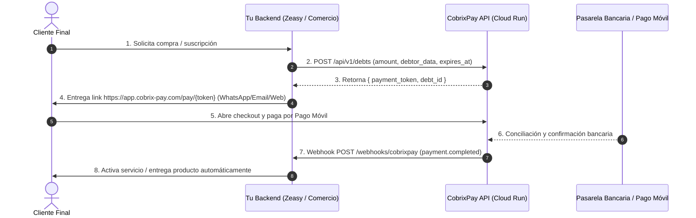

# 💳 Guía Oficial de Integración con CobrixPay API
### Para Desarrolladores, Comercios y Aplicaciones Externas

Esta guía documenta la arquitectura, endpoints y lecciones prácticas aprendidas para integrar cualquier sistema externo (Apps móviles, Tiendas Online, SaaS, Puntos de Venta, ERPs, etc.) con la pasarela de pagos **CobrixPay**.

---

## 🎯 Arquitectura del Flujo en 3 Pasos



---

## 🔑 1. Credenciales y Autenticación

Para consumir la API de CobrixPay, cada comercio dispone de una **Clave de API (`API Key`)** con prefijo `cb_live_` generada para su empresa.

### Variables de Entorno Necesarias en tu Servidor:
```bash
# URL de la API de CobrixPay (Producción GCP Cloud Run)
COBRIXPAY_API_URL=https://cobrix-pay-902301530733.us-central1.run.app

# URL del Frontend / Checkout para clientes finales
COBRIXPAY_BASE_URL=https://app.cobrix-pay.com

# Clave secreta de API del comercio (Generada en el backoffice de CobrixPay)
COBRIXPAY_API_KEY=cb_live_XXXXXXXXXXXXXXXXXXXXXXXXXXXXXXXXXXXXXXXX

# Clave secreta para firmar y validar webhooks (HMAC-SHA256)
COBRIXPAY_WEBHOOK_SECRET=tu_secreto_seguro_para_webhooks
```

> [!IMPORTANT]
> **Lección de Autenticación:**
> Al hacer peticiones a CobrixPay, envía la API Key tanto en el encabezado `X-API-Key` como en `Authorization: Bearer` para máxima compatibilidad con todos los microservicios:
> ```json
> {
>   "X-API-Key": "cb_live_...",
>   "Authorization": "Bearer cb_live_...",
>   "Content-Type": "application/json"
> }
> ```

---

## ⚡ 2. Creación de una Deuda / Enlace de Pago

### Endpoint:
`POST https://cobrix-pay-902301530733.us-central1.run.app/api/v1/debts`

### Payload JSON de Solicitud:
```json
{
  "amount": 2.99,
  "currency_code": "USD",
  "description": "Suscripción Zeasy PRO (1 mes) - Dispositivo 8a9b2c3d",
  "due_date": "2026-10-29",
  "expires_at": "2026-10-23T12:00:00Z",
  "allow_partial_payment": false,
  "debtor_data": {
    "name": "Panadería El Trigal C.A",
    "email": "contacto@eltrigal.com",
    "phone": "+584141234567",
    "document_number": "J-12345678-0",
    "document_type": "RIF"
  }
}
```

### Reglas Críticas para Evitar Errores:
1. **Teléfono:** Debe incluir el prefijo internacional con `+` (ej: `+584141234567`). Si el usuario ingresó `0414...`, remueve el cero y antepón `+58`.
2. **Documento:** Si es persona jurídica usa `"document_type": "RIF"`. Si es persona natural usa `"document_type": "CI"`.
3. **Expiración (`expires_at`):** Configura una fecha UTC ISO-8601 (ejemplo: 24 horas a partir de ahora). Esto asegura que si el cliente no paga a tiempo, el checkout no permita pagos desfasados.

### Respuesta Exitosa (`HTTP 200 / 201`):
```json
{
  "debt_id": 482,
  "payment_token": "a1b2c3d4-e5f6-7890-abcd-ef1234567890",
  "status": "pending",
  "amount": 2.99,
  "currency_code": "USD"
}
```

### Construcción del Enlace Final para el Cliente:
Con el `payment_token` recibido, la URL que le envías al cliente por WhatsApp o correo es:
👉 `https://app.cobrix-pay.com/pay/a1b2c3d4-e5f6-7890-abcd-ef1234567890`

---

## 🔔 3. Recepción de Webhooks (Confirmación Automática)

Cuando el cliente realiza el Pago Móvil y CobrixPay lo concilia, CobrixPay enviará una petición `POST` al endpoint que configuraste en tu backend.

### Configuración en CobrixPay:
Tu webhook debe ser accesible públicamente por HTTPS:
👉 `https://tu-dominio.com/webhooks/cobrixpay`

### Payload Enviado por CobrixPay (`payment.completed`):
```json
{
  "event": "payment.completed",
  "timestamp": "2026-10-22T15:30:00Z",
  "company_id": 5,
  "data": {
    "payment": {
      "payment_id": 1052,
      "debt_id": 482,
      "amount": 2.99,
      "currency": "USD",
      "transaction_id": "010212345678",
      "status": "completed",
      "payment_method": "Pago Móvil",
      "paid_at": "2026-10-22T15:29:45Z"
    },
    "debt": {
      "debt_id": 482,
      "debtor_name": "Panadería El Trigal C.A",
      "debtor_phone": "+584141234567",
      "description": "Suscripción Zeasy PRO (1 mes) - Dispositivo 8a9b2c3d",
      "payment_token": "a1b2c3d4-e5f6-7890-abcd-ef1234567890",
      "status": "paid"
    }
  }
}
```

### Encabezados de Seguridad:
CobrixPay envía la firma en `X-Webhook-Signature` usando HMAC-SHA256:
```python
def verify_cobrixpay_signature(payload: dict, signature_header: str, secret: str) -> bool:
    payload_clean = {k: v for k, v in payload.items() if k != "signature"}
    canonical = json.dumps(payload_clean, sort_keys=True)
    expected = hmac.new(secret.encode(), canonical.encode(), hashlib.sha256).hexdigest()
    return hmac.compare_digest(expected, signature_header)
```

---

## 🛡️ 4. Buenas Prácticas y Patrones Anti-Fallas

### A. Anti-Spam / Reutilización Idempotente de Enlaces
Si un cliente pulsa varias veces "Solicitar enlace", **no crees múltiples deudas en CobrixPay**.
- Guarda en tu base de datos: `pending_debt_id`, `pending_payment_token` y `pending_link_expires_at`.
- Si el usuario vuelve a pedir el link y el actual sigue vigente (`now < expires_at`), **retorna el mismo enlace**.

### B. Anulación de Enlaces Vencidos
Si el plazo expiró y el cliente solicita un nuevo enlace, anula la deuda vieja en CobrixPay para no dejar cobros fantasmas:
`POST https://cobrix-pay-902301530733.us-central1.run.app/api/v1/debts/{debt_id}/cancel`
```json
{ "reason": "Tiempo de pago expirado o reemplazado por el cliente" }
```

### C. Respaldo Reactivo (Polling Fallback)
Los webhooks pueden experimentar retrasos temporales por caídas de internet.
Para una experiencia perfecta de usuario (zero wait):
- Cuando el usuario regrese a tu app o dashboard, consulta el estado de la deuda directamente:
  `GET https://cobrix-pay-902301530733.us-central1.run.app/api/v1/debts/{debt_id}`
- Si CobrixPay responde `"status": "paid"` o `"balance_due": 0`, **activa el servicio inmediatamente** sin tener que esperar a que el webhook llegue.

---

## 💻 5. Ejemplo de Código en Python (FastAPI / Requests)

```python
import requests
from datetime import datetime, timedelta

COBRIX_API = "https://cobrix-pay-902301530733.us-central1.run.app"
API_KEY = "cb_live_TU_CLAVE_AQUI"

def create_payment_link(client_name: str, client_phone: str, amount_usd: float, reference_id: str):
    headers = {
        "X-API-Key": API_KEY,
        "Authorization": f"Bearer {API_KEY}",
        "Content-Type": "application/json"
    }

    expires_at = datetime.utcnow() + timedelta(hours=24)

    payload = {
        "amount": amount_usd,
        "currency_code": "USD",
        "description": f"Orden #{reference_id} - {client_name}",
        "due_date": (datetime.utcnow() + timedelta(days=7)).date().isoformat(),
        "expires_at": expires_at.strftime("%Y-%m-%dT%H:%M:%SZ"),
        "allow_partial_payment": False,
        "debtor_data": {
            "name": client_name,
            "email": f"cliente_{reference_id}@tudominio.com",
            "phone": client_phone if client_phone.startswith("+") else f"+58{client_phone.lstrip('0')}",
            "document_number": "V-00000000",
            "document_type": "CI"
        }
    }

    response = requests.post(f"{COBRIX_API}/api/v1/debts", json=payload, headers=headers, timeout=10)
    response.raise_for_status()

    data = response.json()
    token = data["payment_token"]
    checkout_url = f"https://app.cobrix-pay.com/pay/{token}"

    return {
        "debt_id": data["debt_id"],
        "token": token,
        "checkout_url": checkout_url,
        "expires_at": expires_at
    }
```
